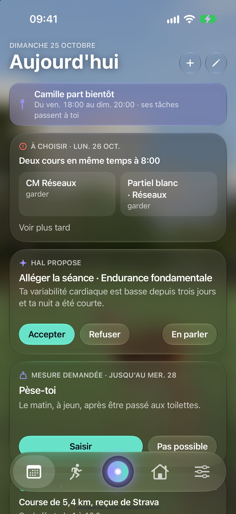
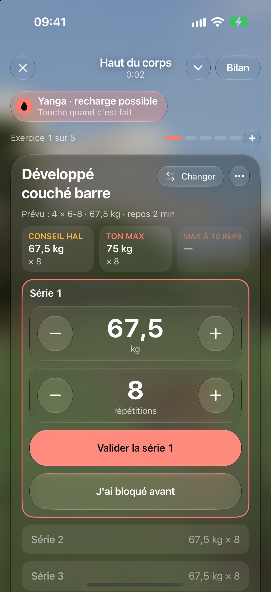
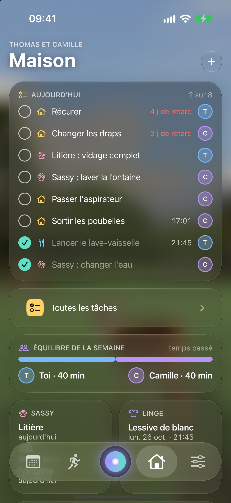
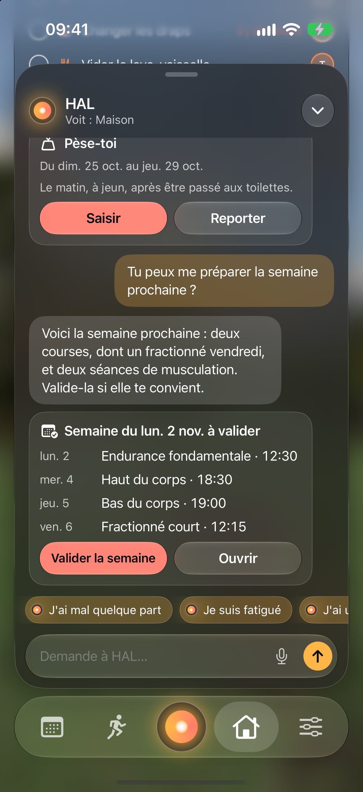
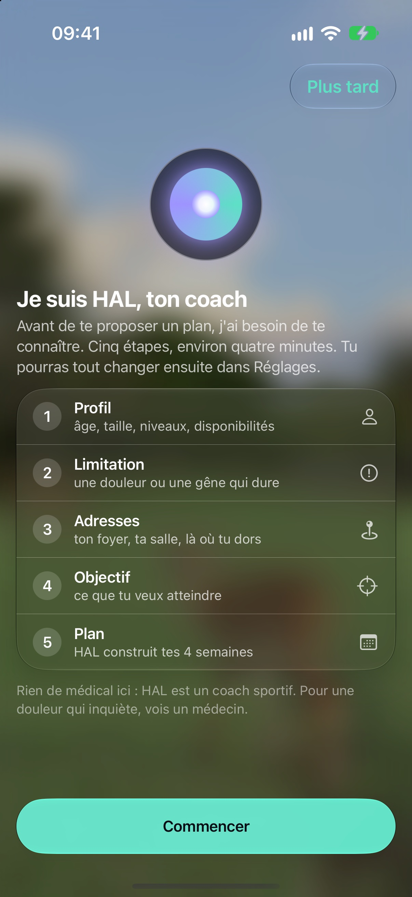
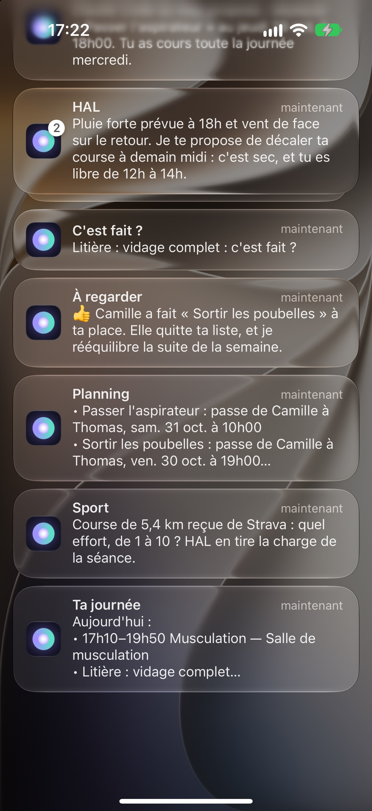
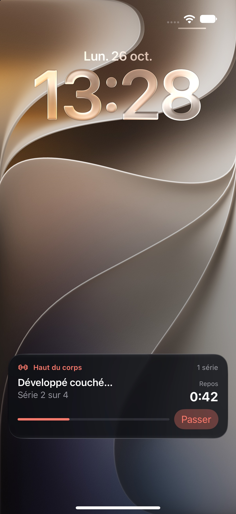
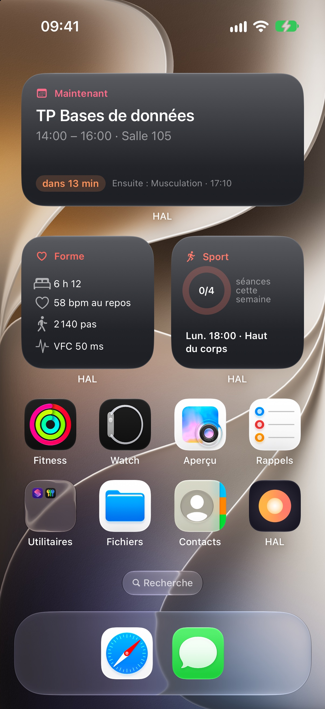
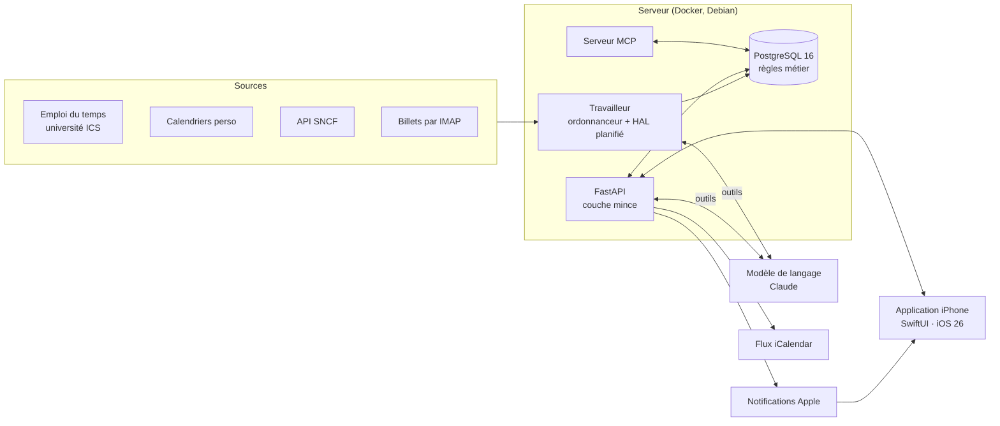

# HAL — planificateur du foyer et coach sportif

Une application iPhone et son serveur, conçus et développés seul, pour ma copine et moi. Le serveur croise les emplois du temps de chacun, en déduit les moments libres, et y place tout seul les tâches de la maison et les séances de sport. HAL, un coach construit sur un modèle de langage, écrit les séances et les ajuste au fil des semaines.

Projet personnel, M1 MIAGE (Université de Lorraine). En usage réel au quotidien depuis l'été 2026.

> **Le code source est privé.** Ce dépôt présente le projet : ce qu'il fait, comment il est construit, et les problèmes qu'il m'a fallu résoudre. Le code est disponible sur demande, pour un entretien par exemple.

---

## Captures

| Aujourd'hui | Séance de musculation | Maison | HAL |
|:---:|:---:|:---:|:---:|
|  |  |  |  |

| Démarrage de HAL | Notifications | Live Activity | Widgets |
|:---:|:---:|:---:|:---:|
|  |  |  |  |

*Captures prises sur une base de démonstration : les données sont inventées.*

---

## L'histoire du projet

### Au départ : placer les tâches tout seul

Je voulais un système qui mette en place automatiquement les tâches de la maison pour ma copine et moi. Nos emplois du temps changent sans arrêt : mes cours bougent chaque semaine, je travaillais alors en horaires variables chez McDonald's, et je rentre souvent chez mes parents en train. Caser une lessive demandait de croiser plusieurs plannings de tête.

Je suis parti sur une base simple : une API en Python, installée sur l'ancien ordinateur portable que m'avait offert la Région Grand Est, et pilotée depuis un bot Telegram. Je lui donnais nos calendriers au format ICS. Il triait les informations, croisait les emplois du temps, repérait les incohérences (deux cours au même moment, un cours publié en double) et posait les tâches dans les créneaux libres.

Dès le début, j'ai construit la base de données avec la démarche apprise en L3 : chaque tâche a des règles strictes, et ces règles sont traduites en contraintes et en fonctions PL/pgSQL. C'est la base elle-même qui refuse ce qui n'a pas de sens, pas le code autour.

### Petit à petit, de nouvelles fonctionnalités

J'ai ajouté des fonctionnalités au fil des besoins : les absences, qui redistribuent les tâches quand l'un de nous part, puis la recherche de trains pour rentrer chez mes parents quand j'ai du temps libre. Certaines ont été abandonnées en route, comme la gestion de mes tenues de travail quand j'étais chez McDonald's.

### Le tournant : l'IA

Le gros changement est venu avec l'IA. Je reprenais le sport, et je demandais à Gemini de me préparer mes séances. C'est là que j'ai eu l'idée d'intégrer un coach IA directement dans le système.

Il fallait alors une vraie application, capable de récupérer les données de ma montre et de Santé. Et comme la partie calendrier existait déjà, l'agent pouvait aussi lire mon emploi du temps.

J'ai appris à construire un véritable agent IA, un coach sportif qui utilise toutes les informations à sa disposition pour me faire des programmes sur mesure. Pour moi, c'est le plus intéressant du projet : j'ai un problème physique qui m'empêche de faire certains mouvements, et le coach en tient compte pour bâtir un programme vraiment personnalisé.

Je lui ai ensuite ouvert la gestion des tâches et des calendriers. L'IA est devenue le cœur de l'application.

### Une application iPhone, personnalisable à l'infini

Le choix de l'iPhone uniquement s'est fait naturellement : nous sommes tous les deux sur iPhone, et Apple rend la récupération des données de santé très simple. J'utilise les fonctionnalités de base de l'iPhone et j'ai suivi le design d'Apple, moderne et cohérent avec le reste du système.

Je voulais une application 100 % personnalisable. Le style Liquid Glass d'iOS 26, en plus d'être moderne, permet de mettre un fond d'écran dans l'application, et donc de la personnaliser à l'infini. L'accueil est fait de widgets qu'on choisit et qu'on range, et on peut réutiliser les mêmes informations dans les widgets de l'écran d'accueil de l'iPhone.

J'ai aussi ajouté MCP : grâce à ça, je peux piloter HAL en dehors de l'application, depuis une conversation avec Claude par exemple. C'est une piste que je veux encore explorer.

### Deux testeurs, des idées tous les jours

Pour l'instant, nous ne sommes que deux à l'utiliser, mais nous en parlons beaucoup : les bugs sont vite corrigés, et les idées arrivent sans arrêt. Un exemple : à la salle, je voulais profiter de la boisson disponible toutes les 20 minutes. Je me suis dit qu'il me fallait une fonctionnalité pour ça, et l'appli me prévient maintenant pendant la séance quand je peux recharger ma gourde.

Au-delà de l'utilité au quotidien, c'est surtout un projet informatique que je mène de A à Z : la base de données, le serveur, l'IA, l'application, le déploiement. J'y apprends énormément.

### La suite

- Améliorer encore l'IA, pour qu'elle soit le meilleur coach possible.
- Une liste de courses, avec une IA qui m'aide à faire mes courses en fonction des promotions.
- Et beaucoup d'autres idées : c'est une application qui sert vraiment tous les jours.

À terme, le but est d'ouvrir l'application à tout le monde. Elle peut servir à des étudiants, à des couples, à des colocations, ou simplement à des gens qui veulent se mettre au sport avec un coach qui les connaît. Je commence déjà à réfléchir à l'offre que je pourrais proposer, et aux personnes qu'elle intéresserait le plus.

---

## Ce que fait l'application

- **Collecte des emplois du temps** : flux iCalendar de l'université, calendriers personnels, saisies à la main. Les doublons et les conflits horaires sont réconciliés automatiquement.
- **Placement automatique** : les tâches récurrentes se posent dans les créneaux libres, un mois à l'avance, la semaine en cours restant figée. Le moteur choisit le jour le moins chargé pour ne pas tout entasser le même soir.
- **Répartition équitable** : les tâches alternent entre les deux membres du foyer, et une balance rééquilibre quand l'écart se creuse. Une absence déclarée (un départ en train, par exemple) redistribue la charge.
- **Trajets et billets** : repérage des week-ends libres, horaires proposés par l'API SNCF, lecture des billets reçus par courriel pour déclarer l'absence tout seul.
- **HAL, le coach sportif** : un plan de quatre semaines construit à partir d'objectifs, une séance proposée avec ses exercices, un suivi de ce qui est fait (données de l'Apple Watch, séries de musculation saisies dans l'appli) et des ajustements : récap le soir, révision le dimanche, réaction immédiate à une douleur signalée.
- **Mémoire de HAL** : résumée chaque nuit sur quatre niveaux, de la semaine en cours aux mois passés, visible et corrigeable dans l'appli.
- **Lieux et météo** : trajets calculés sur OpenStreetMap, rappels selon l'arrivée sur un lieu (sans garder de tracé), course déplacée si la météo est mauvaise.
- **HAL en serveur MCP** : Claude Code, Claude Desktop ou Gemini CLI peuvent lire le planning et proposer des changements, qui attendent un accord donné dans l'appli.
- **Côté iPhone** : interface Liquid Glass d'iOS 26, widgets, Live Activity pendant le repos entre deux séries, saisie hors ligne, notifications.

---

## Le parti pris technique

**Les règles métier vivent dans PostgreSQL, pas dans le code Python.** C'est le choix structurant du projet, et le sujet de mon cours de conception de systèmes d'information.

L'API est une couche mince : elle appelle des fonctions et expose des vues, elle ne décide de rien. Si un script, une saisie manuelle ou l'appli contourne l'API, la base refuse quand même ce qui est incohérent.

| Règle | Où elle est tenue |
|---|---|
| Deux cours ne peuvent pas se chevaucher | Contrainte `EXCLUDE USING gist` |
| Une tâche faite ne peut plus être modifiée | Trigger |
| Le grand ménage exige que les deux soient libres | Intersection de `tstzmultirange` |
| Une tâche est « en retard » | Une seule vue, donc une seule définition |
| HAL ne place pas un exercice interdit par une blessure | Fonction SQL appelée par ses outils |
| HAL ne modifie pas seul une séance déjà validée | Fonction SQL |

Les moments libres se calculent en une soustraction d'ensembles, sans boucle :

```sql
-- Les moments libres : l'horizon, moins tout ce qui l'occupe.
SELECT unnest(
    tstzmultirange(tstzrange(p_debut, p_fin, '[)'))
    - COALESCE((SELECT range_agg(plage) FROM occupe), '{}'::TSTZMULTIRANGE)
);
```

**HAL n'écrit jamais directement dans la base.** Le modèle de langage dispose d'une liste fermée d'outils, chacun adossé à une fonction SQL qui vérifie le créneau, les limitations physiques et le repos, puis accepte ou renvoie son motif de refus. Le modèle propose, la base dispose.

---

## Architecture



| | |
|---|---|
| **Serveur** | Python 3.12, FastAPI, psycopg 3 sans ORM, PostgreSQL 16, APScheduler |
| **IA** | API Claude (Anthropic), boucle d'appel d'outils écrite à la main, serveur MCP, mémoire résumée chaque nuit |
| **iPhone** | SwiftUI, HealthKit, WidgetKit, ActivityKit, WorkoutKit (Apple Watch), XcodeGen |
| **Infra** | Docker Compose sur un portable de récupération sous Debian, accès par Tailscale sans port ouvert |
| **Livraison** | Un `git push` déploie le serveur (sauvegarde, migrations, redémarrage, sonde de santé) et envoie l'appli sur TestFlight. Tests et linter à chaque push sur GitHub Actions |

---

## En chiffres

| | |
|---|---|
| Durée | depuis août 2026, en parallèle du master |
| Code | environ 95 000 lignes : Python, SQL et Swift |
| Base de données | 70 tables, 83 migrations versionnées |
| Tests | plus de 950, sur une vraie base PostgreSQL |
| Application | 90 fichiers Swift, 4 onglets, widgets et Live Activity |

---

## Quelques problèmes rencontrés

**Le flux de l'université publie chaque cours deux fois**, avec le même identifiant : une version vide et une version complète. Réconcilier naïvement faisait parfois gagner la version vide, et la salle disparaissait. La fusion garde maintenant la version la plus informative.

**Une collecte perdait six cours en silence.** « 80 lues, 51 créées », sans explication de l'écart. J'ai ajouté un invariant : chaque séance lue doit être comptée quelque part, sinon l'écart est signalé. C'est ce contrôle qui a révélé le bug.

**Toutes les tâches se posaient le même soir.** Le moteur prenait le premier créneau libre, ce qui entassait sept rappels sur un seul jour, et aucun n'était fait. Il choisit maintenant le jour le moins chargé.

**Les tâches de nuit tournaient deux heures trop tard.** Le conteneur vit en UTC ; l'ordonnanceur était bien réglé sur Paris, mais un déclencheur construit à la main fige son propre fuseau. Le « report de minuit » partait à 2 h, une fois la date changée. Le fuseau est maintenant passé explicitement partout.

**« Pourquoi l'appli a fait ça ? » demandait de relire le code.** J'ai ajouté un journal : chaque changement garde ce qui a changé, qui l'a déclenché et dans quelle action. Chaque notification en tire sa raison, en une phrase.

**HAL coûtait surtout avant de réfléchir.** Chaque appel commençait par plusieurs lectures qui renvoyaient toute la consigne au modèle. Ce qu'il lit à coup sûr lui est maintenant donné dès le premier message, et son dossier part par morceaux selon le sujet.

---

## Contact

Je cherche un stage en développement. Pour voir le code ou en parler :

- LinkedIn : *à compléter*
- Courriel : *à compléter*

© 2026 Thomas Mathis. Tous droits réservés.
