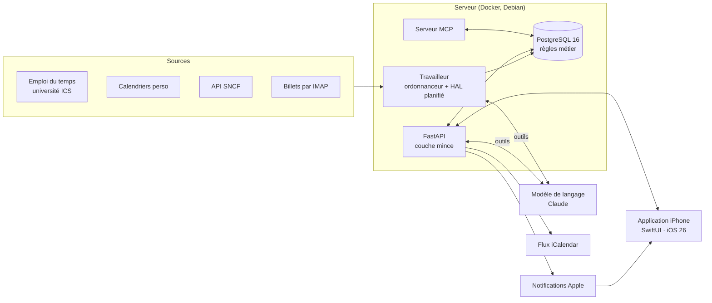

# HAL — planificateur du foyer et coach sportif

Une application iPhone et son serveur, conçus et développés seul, pour un foyer de deux personnes. Le serveur croise les emplois du temps de chacun, en déduit les moments libres, et y place tout seul les tâches de la maison et les séances de sport. HAL, un coach construit sur un modèle de langage, écrit les séances et les ajuste au fil des semaines.

Projet personnel, M1 MIAGE (Université de Lorraine). En usage réel au quotidien depuis l'été 2026.

> **Le code source est privé.** Ce dépôt présente le projet : ce qu'il fait, comment il est construit, et les problèmes qu'il m'a fallu résoudre. Le code est disponible sur demande, pour un entretien par exemple.

---

## Captures

| Aujourd'hui | Séance de musculation | Maison | HAL |
|:---:|:---:|:---:|:---:|
|  |  |  |  |

| Démarrage de HAL | Notifications | Live Activity | Widgets |
|:---:|:---:|:---:|:---:|
|  |  |  |  |

*Captures prises sur une base de démonstration : les données sont inventées.*

---

## Le problème

Nous sommes deux dans l'appartement. Mes cours changent chaque semaine, j'ai longtemps travaillé en horaires variables, et je pars régulièrement en train voir ma famille. Le ménage, les lessives et le sport passaient à la trappe. Pas par mauvaise volonté : les caser demande de croiser de tête plusieurs plannings qui bougent tout le temps.

Le système fait ce croisement à notre place.

---

## Ce que fait l'application

- **Collecte des emplois du temps** : flux iCalendar de l'université, calendriers personnels, saisies à la main. Les doublons et les conflits horaires sont réconciliés automatiquement.
- **Placement automatique** : les tâches récurrentes se posent dans les créneaux libres, un mois à l'avance, la semaine en cours restant figée. Le moteur choisit le jour le moins chargé pour ne pas tout entasser le même soir.
- **Répartition équitable** : les tâches alternent entre les deux membres du foyer, et une balance rééquilibre quand l'écart se creuse. Une absence déclarée (un départ en train, par exemple) redistribue la charge.
- **Trajets et billets** : repérage des week-ends libres, horaires proposés par l'API SNCF, lecture des billets reçus par courriel pour déclarer l'absence tout seul.
- **HAL, le coach sportif** : un plan de quatre semaines construit à partir d'objectifs, une séance proposée avec ses exercices, un suivi de ce qui est fait (données de l'Apple Watch, séries de musculation saisies dans l'appli) et des ajustements : récap le soir, révision le dimanche, réaction immédiate à une douleur signalée.
- **Mémoire de HAL** : résumée chaque nuit sur quatre niveaux, de la semaine en cours aux mois passés, visible et corrigeable dans l'appli.
- **Lieux et météo** : trajets calculés sur OpenStreetMap, rappels selon l'arrivée sur un lieu (sans garder de tracé), course déplacée si la météo est mauvaise.
- **HAL en serveur MCP** : Claude Code, Claude Desktop ou Gemini CLI peuvent lire le planning et proposer des changements, qui attendent un accord donné dans l'appli.
- **Côté iPhone** : interface Liquid Glass d'iOS 26, widgets, Live Activity pendant le repos entre deux séries, saisie hors ligne, notifications.

---

## Le parti pris technique

**Les règles métier vivent dans PostgreSQL, pas dans le code Python.** C'est le choix structurant du projet, et le sujet de mon cours de conception de systèmes d'information.

L'API est une couche mince : elle appelle des fonctions et expose des vues, elle ne décide de rien. Si un script, une saisie manuelle ou l'appli contourne l'API, la base refuse quand même ce qui est incohérent.

| Règle | Où elle est tenue |
|---|---|
| Deux cours ne peuvent pas se chevaucher | Contrainte `EXCLUDE USING gist` |
| Une tâche faite ne peut plus être modifiée | Trigger |
| Le grand ménage exige que les deux soient libres | Intersection de `tstzmultirange` |
| Une tâche est « en retard » | Une seule vue, donc une seule définition |
| HAL ne place pas un exercice interdit par une blessure | Fonction SQL appelée par ses outils |
| HAL ne modifie pas seul une séance déjà validée | Fonction SQL |

Les moments libres se calculent en une soustraction d'ensembles, sans boucle :

```sql
-- Les moments libres : l'horizon, moins tout ce qui l'occupe.
SELECT unnest(
    tstzmultirange(tstzrange(p_debut, p_fin, '[)'))
    - COALESCE((SELECT range_agg(plage) FROM occupe), '{}'::TSTZMULTIRANGE)
);
```

**HAL n'écrit jamais directement dans la base.** Le modèle de langage dispose d'une liste fermée d'outils, chacun adossé à une fonction SQL qui vérifie le créneau, les limitations physiques et le repos, puis accepte ou renvoie son motif de refus. Le modèle propose, la base dispose.

---

## Architecture



| | |
|---|---|
| **Serveur** | Python 3.12, FastAPI, psycopg 3 sans ORM, PostgreSQL 16, APScheduler |
| **IA** | API Claude (Anthropic), boucle d'appel d'outils écrite à la main, serveur MCP, mémoire résumée chaque nuit |
| **iPhone** | SwiftUI, HealthKit, WidgetKit, ActivityKit, WorkoutKit (Apple Watch), XcodeGen |
| **Infra** | Docker Compose sur un portable de récupération sous Debian, accès par Tailscale sans port ouvert |
| **Livraison** | Un `git push` déploie le serveur (sauvegarde, migrations, redémarrage, sonde de santé) et envoie l'appli sur TestFlight. Tests et linter à chaque push sur GitHub Actions |

---

## En chiffres

| | |
|---|---|
| Durée | depuis août 2026, en parallèle du master |
| Code | environ 95 000 lignes : Python, SQL et Swift |
| Base de données | 70 tables, 83 migrations versionnées |
| Tests | plus de 950, sur une vraie base PostgreSQL |
| Application | 90 fichiers Swift, 4 onglets, widgets et Live Activity |

---

## Quelques problèmes rencontrés

**Le flux de l'université publie chaque cours deux fois**, avec le même identifiant : une version vide et une version complète. Réconcilier naïvement faisait parfois gagner la version vide, et la salle disparaissait. La fusion garde maintenant la version la plus informative.

**Une collecte perdait six cours en silence.** « 80 lues, 51 créées », sans explication de l'écart. J'ai ajouté un invariant : chaque séance lue doit être comptée quelque part, sinon l'écart est signalé. C'est ce contrôle qui a révélé le bug.

**Toutes les tâches se posaient le même soir.** Le moteur prenait le premier créneau libre, ce qui entassait sept rappels sur un seul jour, et aucun n'était fait. Il choisit maintenant le jour le moins chargé.

**Les tâches de nuit tournaient deux heures trop tard.** Le conteneur vit en UTC ; l'ordonnanceur était bien réglé sur Paris, mais un déclencheur construit à la main fige son propre fuseau. Le « report de minuit » partait à 2 h, une fois la date changée. Le fuseau est maintenant passé explicitement partout.

**« Pourquoi l'appli a fait ça ? » demandait de relire le code.** J'ai ajouté un journal : chaque changement garde ce qui a changé, qui l'a déclenché et dans quelle action. Chaque notification en tire sa raison, en une phrase.

**HAL coûtait surtout avant de réfléchir.** Chaque appel commençait par plusieurs lectures qui renvoyaient toute la consigne au modèle. Ce qu'il lit à coup sûr lui est maintenant donné dès le premier message, et son dossier part par morceaux selon le sujet.

---

## Contact

Je cherche un stage en développement. Pour voir le code ou en parler :

- LinkedIn : *à compléter*
- Courriel : *à compléter*

© 2026 Thomas Mathis. Tous droits réservés.
